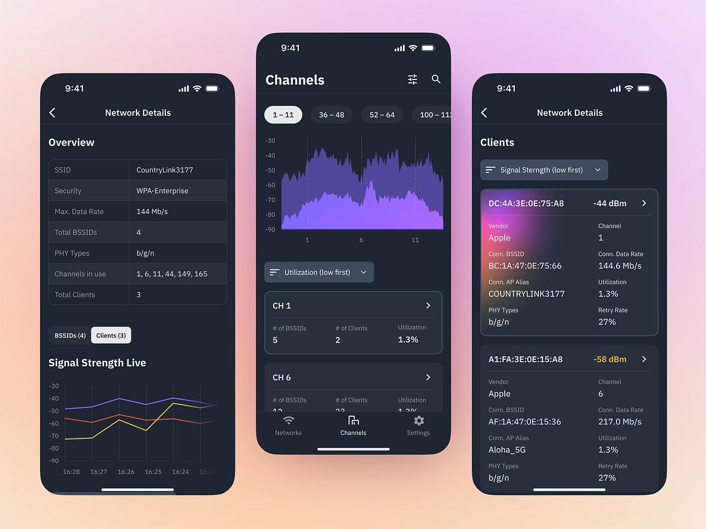
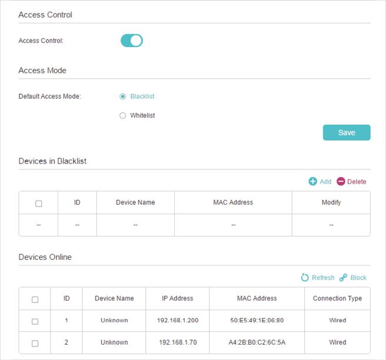

# WiFiKill Reloaded — Product Architecture & Roadmap

> Status: Drafted
> Product: WiFiKill Reloaded
> Owner: Sankaré Technology
> Platform: Android

## Overview

Build this as a native Android network management product, not simply a clone of the original WiFiKill.

The product should have three distinguishing characteristics:

- Work across different router manufacturers through an extensible integration system.
- Offer advanced functionality on rooted devices without making root mandatory for basic features.
- Provide reliable network access management rather than relying on fragile network interception techniques.

One important architectural decision: router-authorized access control should be the primary enforcement mechanism. The commercial product should not be built around ARP spoofing, deauthentication, or silently disrupting other people's connections. Those approaches are unreliable across modern networks and unsuitable as a dependable product foundation.

## 1. Product vision



### WiFiKill Reloaded

Network visibility. Device intelligence. Access management.

A mobile-first network administration toolkit for discovering, monitoring, and managing devices on networks the user owns or is authorized to administer.

### Product modules

| Module              | Main capabilities                                    |
| ------------------- | ---------------------------------------------------- |
| Network Scanner     | LAN discovery, subnet scanning                       |
| Device Intelligence | IP, MAC, hostname, vendor identification             |
| Live Monitor        | Device status, traffic and latency                   |
| Access Manager      | Router-based allow/block policies                    |
| Network Diagnostics | Ping, DNS, gateway, connectivity                     |
| Network History     | Device activity and historical records               |
| Router Manager      | Router detection, configuration and integrations     |
| Advanced Tools      | Root-enabled diagnostics and device-level inspection |

### Product positioning

Target three types of customers:

- Individual users managing home Wi-Fi.
- Small businesses managing office networks.
- IT technicians and network administrators.

This gives a wider market than a simple WiFiKill replacement.

## 2. Technical architecture

A modular architecture with four major layers.

```text
Android Application — Kotlin + Jetpack Compose
Dashboard · Devices · Monitoring · Access Policies · Settings

Network Engine
Discovery, scanning, diagnostics, traffic statistics

Router Integration Engine
Router detection, authentication, vendor adapters, policies

Root Service
Optional privileged diagnostics, isolated execution

Local Storage
Room database, preferences, encrypted credentials

Network Infrastructure
Wi-Fi · LAN · Router APIs · DHCP · Firewall · Gateway

Optional Cloud Platform
User accounts · Premium licensing · Subscription management · Backup · Multi-network management
```

The application should remain fully functional for local scanning and diagnostics without requiring an account or cloud connection.

### Recommended technology stack

| Component            | Technology                      |
| -------------------- | ------------------------------- |
| Android              | Kotlin                          |
| UI                   | Jetpack Compose                 |
| Architecture         | Clean Architecture + MVVM       |
| Dependency injection | Hilt                            |
| Local database       | Room / SQLite                   |
| Background tasks     | WorkManager                     |
| Networking           | OkHttp + Kotlin Coroutines      |
| Secure credentials   | Android Keystore                |
| Root integration     | Minimal isolated native service |
| Backend              | NestJS + TypeScript             |
| Backend database     | PostgreSQL                      |
| Cache / jobs         | Redis + BullMQ                  |
| API documentation    | Swagger / OpenAPI               |
| Infrastructure       | Docker                          |

Kotlin is preferred over React Native for the Android application itself. Root access, Android permissions, Wi-Fi APIs, and system-level integration are easier to manage natively. NestJS can handle the optional cloud backend.

## 3. Router compatibility strategy

This is probably the most important architectural challenge.

There is no single universal API that allows an Android application to block arbitrary devices on every Wi-Fi router.

Instead, use a Router Adapter Architecture.

```text
Router Integration Engine

Common Router Interface
Discover · Authenticate · List Devices · Apply Policy · Remove Policy
```

| Adapter | Priority | Interface |
| --- | --- | --- |
| OpenWrt | 1 | ubus / RPC / firewall |
| MikroTik | 1 | RouterOS API / REST |
| TP-Link | 2 | Supported model-specific interfaces |
| Huawei | 2 | Model-specific integration |
| Generic | — | Read-only discovery and diagnostics when no supported management API exists |

### Why start with OpenWrt and MikroTik?

They offer better opportunities for documented, programmable management.

- OpenWrt provides ubus-based RPC and firewall integration.
- MikroTik offers RouterOS APIs and REST endpoints, including firewall address-list management.

References: [OpenWrt ubus documentation](https://openwrt.org/docs/techref/ubus) · [MikroTik REST API](https://manual.mikrotik.com/docs/developer-guides/rest-api/).

For example, MikroTik firewall address lists can be used as part of an administrator-configured blocking policy.

> Important: Router compatibility must be model- and firmware-aware. Detecting that a router is TP-Link or Huawei does not automatically mean its management interface is accessible.

### Adapter contract

Every router integration should implement a shared interface:

```kotlin
interface RouterAdapter {
    suspend fun connect(config: RouterConfig): ConnectionResult

    suspend fun getRouterInfo(): RouterInfo

    suspend fun discoverDevices(): List<NetworkDevice>

    suspend fun getAccessPolicies(): List<AccessPolicy>

    suspend fun applyAccessPolicy(
        policy: AccessPolicy
    ): PolicyResult

    suspend fun removeAccessPolicy(
        policyId: String
    ): PolicyResult

    suspend fun disconnect()
}
```

This allows adding more manufacturers without rewriting the application.

## 4. Root integration strategy

Since root is acceptable, an advanced mode can be introduced. However, root should be optional, isolated, and narrowly scoped.

### Two execution modes

| Capability                 | Standard mode                 | Root mode                |
| -------------------------- | ----------------------------- | ------------------------ |
| Device discovery           | Yes                           | Yes                      |
| IP/MAC identification      | Yes, subject to OS visibility | Extended inspection      |
| Ping and diagnostics       | Yes                           | Yes                      |
| Router management          | Yes                           | Yes                      |
| Local interface inspection | Limited                       | Extended                 |
| Advanced packet statistics | Limited                       | Extended where supported |

### Root architecture

```text
Android UI Process
Unprivileged application
        │
        ▼ Restricted IPC
Root Service
Privileged component
Small native helper with an explicit command allowlist
        │
        ▼
Approved System Operations
Interface inspection · Diagnostic operations · Controlled system queries
```

Avoid giving the root process arbitrary shell-command execution. Android's own security guidance recommends minimizing root processes, isolating privileged functionality, and keeping root services away from network listeners.

For root authorization, investigate compatibility with Magisk and KernelSU, while ensuring the app works without either.

## 5. Application structure

Organize the Android project by feature rather than creating one giant networking module.

```text
wifikill-reloaded/
│
├── app/
│   ├── navigation/
│   ├── theme/
│   └── MainActivity.kt
│
├── core/
│   ├── common/
│   ├── database/
│   ├── security/
│   ├── networking/
│   └── permissions/
│
├── domain/
│   ├── models/
│   ├── repositories/
│   └── usecases/
│
├── data/
│   ├── local/
│   ├── remote/
│   └── repositories/
│
├── features/
│   ├── dashboard/
│   ├── network-discovery/
│   ├── devices/
│   ├── monitoring/
│   ├── access-control/
│   ├── diagnostics/
│   ├── router-management/
│   ├── history/
│   └── settings/
│
├── integrations/
│   ├── router/
│   │   ├── openwrt/
│   │   ├── mikrotik/
│   │   ├── tplink/
│   │   └── generic/
│   │
│   └── root/
│       ├── RootManager.kt
│       └── RootBridge.kt
│
└── background/
    ├── NetworkMonitorWorker.kt
    └── DeviceRefreshWorker.kt
```

### Important Android compatibility consideration

Account for Android's evolving local-network permissions.

For example, Android 17 introduces the mandatory `ACCESS_LOCAL_NETWORK` permission for applications targeting API 37 and above. Wi-Fi scanning also has its own permission requirements. Implement a permission abstraction rather than hardcoding assumptions about one Android version.

## 6. Data model

The first version needs a relatively small but extensible domain model.

| Entity            | Important attributes                     |
| ----------------- | ---------------------------------------- |
| Network           | id, SSID, gateway, subnet, interface     |
| Router            | id, IP, vendor, model, firmware, adapter |
| Device            | id, MAC, IP, hostname, vendor            |
| DeviceObservation | deviceId, timestamp, status              |
| AccessPolicy      | deviceId, action, status, expiration     |
| ScanSession       | networkId, startTime, endTime            |
| TrafficSample     | deviceId, timestamp, bytesIn, bytesOut   |
| UserSettings      | scan interval, monitoring preferences    |

A useful design decision: distinguish a physical device from its IP address.

A device can receive a new DHCP address, disconnect, reconnect, or randomize its MAC address. Therefore, preserve observation history and avoid treating IP addresses as permanent identities.

## 7. UI/UX direction

Use a premium dark interface with a clean network operations aesthetic.

<!-- Image unavailable at capture time: ui-netmonitor -->


### Dashboard

Network overview, connected devices, health indicators.

<!-- Image unavailable at capture time: ui-network-scanner -->


### Device explorer

Device inventory, filters, identification.

<!-- Image unavailable at capture time: ui-mikrotik-topology -->


### Monitoring

Traffic trends, connectivity, and latency.



### Access management

Authorized device policies and their status.

Bottom navigation:

- Home
- Devices
- Monitor
- Tools
- Settings

## 8. Development roadmap

A six-phase development plan. Do not attempt to implement every router integration before validating the core engine.

### Phase 1 — Foundation

MVP prerequisite

- Android project setup
- Compose design system
- Network interface detection
- Permissions and connectivity management
- Room database
- Root detection and permission flow

Estimated: 4–5 days

### Phase 2 — Network Discovery

- LAN device discovery
- IP and MAC identification
- Hostname and vendor lookup
- Device inventory
- Scan history
- Device detail screens

Estimated: 5–7 days

### Phase 3 — Router Integration

- Adapter architecture
- OpenWrt integration
- MikroTik integration
- Router authentication
- Device synchronization
- Authorized access policies

Estimated: 7–10 days

### Phase 4 — Advanced Monitoring

- Live device status
- Traffic statistics
- Latency monitoring
- Network diagnostics
- Root-enabled inspection
- Background monitoring

Estimated: 5–7 days

### Phase 5 — Productization

- Onboarding
- Premium features
- Licensing
- Error reporting
- Security hardening
- Offline functionality

Estimated: 5–7 days

### Phase 6 — Testing and Release

- Rooted and non-rooted device testing
- Android compatibility
- Router compatibility matrix
- Performance testing
- Privacy policy
- Play Store preparation

Estimated: 5–7 days

Planning estimates for an experienced developer, not guaranteed delivery dates. Router availability and firmware differences may extend integration work.

Estimated initial release: 5–7 weeks.

## 9. Product monetization

Since this is intended to become a commercial product, do not make the basic network scanner subscription-only. A freemium model is more appropriate.

| Feature               | Free    | Pro      |
| --------------------- | ------- | -------- |
| Network scanning      | Yes     | Yes      |
| Device identification | Yes     | Yes      |
| Network diagnostics   | Yes     | Yes      |
| Device history        | Limited | Full     |
| Advanced monitoring   | —       | Yes      |
| Router integrations   | Basic   | Advanced |
| Multiple networks     | Limited | Yes      |
| Export reports        | —       | Yes      |

Potential future plans:

- Free: Personal network discovery.
- Pro: Advanced network administration.
- Technician: Multiple customer networks and reporting.
- Business: Centralized management and team access.

Cloud subscriptions should be optional. The local application should retain its core functionality even if the backend is unavailable.

## 10. Testing strategy

Test against actual hardware, not just simulated networks.

| Test environment           | Purpose                    |
| -------------------------- | -------------------------- |
| Android rooted device      | Root integration           |
| Android non-rooted device  | Standard compatibility     |
| OpenWrt router             | First router integration   |
| MikroTik router            | Second router integration  |
| TP-Link router             | Compatibility research     |
| Huawei router              | Compatibility research     |
| Multiple connected devices | Discovery accuracy         |
| Guest Wi-Fi                | Network isolation behavior |

Also test:

- MAC randomization.
- DHCP address changes.
- IPv4 and IPv6.
- Client isolation.
- Different Wi-Fi bands.
- Router credential failures.
- Internet outages.
- Permission revocation.

One important limitation: some routers isolate wireless clients, preventing one device from discovering another. The application must distinguish between an actual absence of devices and a network that prevents discovery.

## 11. Final technical decisions

Architecture to freeze for the first development iteration.

| Decision             | Selection                 |
| -------------------- | ------------------------- |
| Product              | WiFiKill Reloaded         |
| Platform             | Android                   |
| Language             | Kotlin                    |
| UI                   | Jetpack Compose           |
| Architecture         | Clean Architecture / MVVM |
| Database             | Room                      |
| Root                 | Optional advanced mode    |
| Router strategy      | Adapter-based             |
| Initial integrations | OpenWrt + MikroTik        |
| Discovery            | Local network scanning    |
| Access enforcement   | Authorized router APIs    |
| Backend              | Optional NestJS           |
| Database backend     | PostgreSQL                |
| Monetization         | Freemium                  |

## 12. Suggested execution order

Split the project into three deliverables:

- **Deliverable A — Product Specification** (start here): Complete PRD, user stories, functional requirements, acceptance criteria, non-functional requirements, and product boundaries.
- **Deliverable B — Engineering Blueprint**: Detailed architecture, module contracts, database schema, router adapter interfaces, permissions, root-service design, and security model.
- **Deliverable C — Development Backlog**: Epics, stories, technical tasks, dependencies, test cases, and implementation sequence suitable for an AI coding agent such as OpenCode or Claude Code.

## Recommendation

Do not start by implementing the original WiFiKill's interception mechanism. Start with network discovery, device intelligence, and the router adapter system. These are the foundations of a sustainable product.

Also make router integrations independently testable so that adding a new manufacturer does not destabilize the rest of the application.

The immediate next step is Deliverable A: establish the complete PRD and freeze the MVP scope before generating the codebase and implementation tasks.

For ongoing development, establish a weekly architecture and implementation review.
