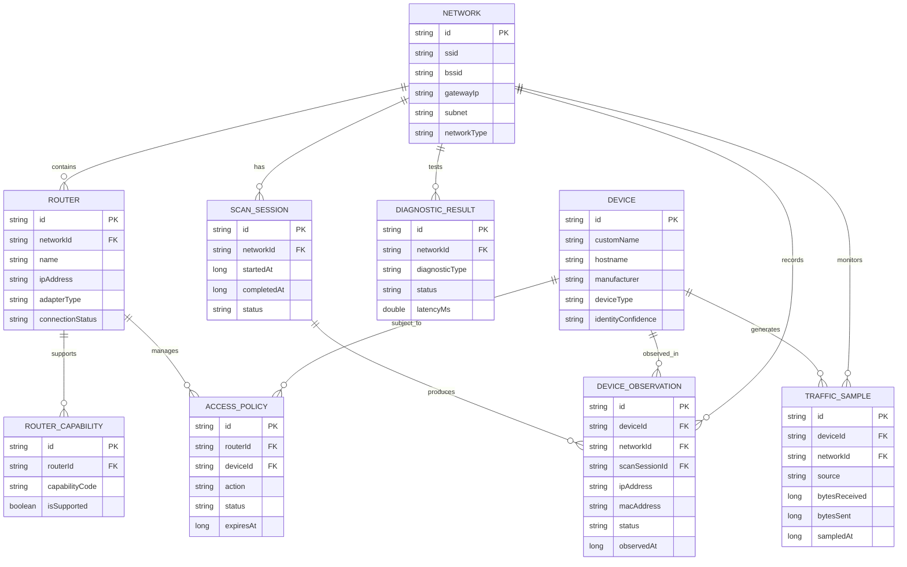

# WiFiKill Reloaded — Database Architecture & ERD

> Technical Design 01 — MVP v1.0
> Status: Drafted

The database will be the foundation of device discovery, network history, monitoring, and router management.

Use Room + SQLite as the primary database, with a local-first architecture. PostgreSQL or a cloud backend is not needed to make the first release work.

## 1. Database design principles

Five principles guide the schema:

- Separate physical device identity from network observations.
- Support multiple networks and routers.
- Preserve historical information without duplicating devices unnecessarily.
- Keep router credentials outside ordinary database tables.
- Design for future synchronization without making cloud services mandatory.

### Database technology

| Component             | Choice                             |
| --------------------- | ---------------------------------- |
| Database              | SQLite                             |
| Android persistence   | Room                               |
| Database access       | DAO                                |
| Schema management     | Room migrations                    |
| Serialization         | Kotlin Serialization               |
| Sensitive credentials | Android Keystore-backed encryption |
| Cloud database later  | PostgreSQL                         |

## 2. Entity relationship model

Ten core entities for the initial database.

### Database entity overview

- **Network** — Saved network profiles
- **Router** — Router configuration
- **Device** — Logical device identity
- **ScanSession** — Discovery executions
- **DeviceObservation** — Historical network presence
- **AccessPolicy** — Router-authorized restrictions
- **TrafficSample** — Traffic measurements
- **DiagnosticResult** — Network test results
- **RouterCapability** — Supported router operations
- **AppSettings** — Local configuration

## 3. Entity definitions

### 3.1 Network

Stores known network profiles.

| Field         | Type    | Constraint    |
| ------------- | ------- | ------------- |
| id            | UUID    | PK            |
| ssid          | String? | Nullable      |
| bssid         | String? | Nullable      |
| gatewayIp     | String? | Nullable      |
| subnet        | String? | Nullable      |
| interfaceName | String? | Nullable      |
| networkType   | String  | Required      |
| isCurrent     | Boolean | Default false |
| firstSeenAt   | Long    | Required      |
| lastSeenAt    | Long    | Required      |

A network is identified using available network attributes, not SSID alone. SSIDs are not globally unique.

### 3.2 Router

Stores router identification and integration configuration.

| Field            | Type    | Constraint |
| ---------------- | ------- | ---------- |
| id               | UUID    | PK         |
| networkId        | UUID    | FK         |
| name             | String  | Required   |
| ipAddress        | String  | Required   |
| manufacturer     | String? | Nullable   |
| model            | String? | Nullable   |
| firmwareVersion  | String? | Nullable   |
| adapterType      | String  | Required   |
| connectionStatus | String  | Required   |
| lastConnectedAt  | Long?   | Nullable   |
| createdAt        | Long    | Required   |

Router passwords and tokens should not be stored in this entity. The entity stores a reference to a separately protected credential record in Android's secure storage.

### 3.3 Device

Stores logical device identity and user-defined metadata.

| Field              | Type    | Constraint      |
| ------------------ | ------- | --------------- |
| id                 | UUID    | PK              |
| customName         | String? | Nullable        |
| hostname           | String? | Nullable        |
| manufacturer       | String? | Nullable        |
| deviceType         | String  | Default UNKNOWN |
| identityConfidence | String  | Required        |
| isTrusted          | Boolean | Default false   |
| notes              | String? | Nullable        |
| createdAt          | Long    | Required        |
| updatedAt          | Long    | Required        |

> Important: this table must not use IP address as its primary identity.

A device may change its IP address or MAC address. Device matching should use confidence-based identity resolution rather than assuming that one identifier is permanent.

### 3.4 ScanSession

Represents one network discovery operation.

| Field        | Type    | Constraint |
| ------------ | ------- | ---------- |
| id           | UUID    | PK         |
| networkId    | UUID    | FK         |
| startedAt    | Long    | Required   |
| completedAt  | Long?   | Nullable   |
| status       | String  | Required   |
| devicesFound | Int     | Default 0  |
| scanMethod   | String  | Required   |
| errorMessage | String? | Nullable   |

### 3.5 DeviceObservation

Stores each device's observed presence on a network.

| Field          | Type    | Constraint |
| -------------- | ------- | ---------- |
| id             | UUID    | PK         |
| deviceId       | UUID    | FK         |
| networkId      | UUID    | FK         |
| scanSessionId  | UUID?   | FK         |
| ipAddress      | String? | Nullable   |
| macAddress     | String? | Nullable   |
| hostname       | String? | Nullable   |
| status         | String  | Required   |
| responseTimeMs | Double? | Nullable   |
| observedAt     | Long    | Required   |

This table is particularly important because it allows maintaining historical device activity.

### 3.6 AccessPolicy

Stores router-based access-control operations.

| Field                 | Type    | Constraint |
| --------------------- | ------- | ---------- |
| id                    | UUID    | PK         |
| routerId              | UUID    | FK         |
| deviceId              | UUID    | FK         |
| action                | String  | Required   |
| status                | String  | Required   |
| routerPolicyReference | String? | Nullable   |
| reason                | String? | Nullable   |
| createdAt             | Long    | Required   |
| updatedAt             | Long    | Required   |
| expiresAt             | Long?   | Nullable   |

Suggested statuses:

- PENDING
- APPLIED
- FAILED
- REMOVED
- UNKNOWN

### 3.7 TrafficSample

Stores traffic measurements when a reliable source is available.

| Field         | Type   | Constraint |
| ------------- | ------ | ---------- |
| id            | UUID   | PK         |
| deviceId      | UUID   | FK         |
| networkId     | UUID   | FK         |
| source        | String | Required   |
| bytesReceived | Long?  | Nullable   |
| bytesSent     | Long?  | Nullable   |
| sampledAt     | Long   | Required   |

The `source` field is important: router counters, local interface statistics, and other measurement sources must not be presented as equivalent.

### 3.8 DiagnosticResult

Stores network diagnostic execution results.

| Field          | Type    | Constraint |
| -------------- | ------- | ---------- |
| id             | UUID    | PK         |
| networkId      | UUID    | FK         |
| diagnosticType | String  | Required   |
| target         | String? | Nullable   |
| status         | String  | Required   |
| latencyMs      | Double? | Nullable   |
| resultMessage  | String? | Nullable   |
| executedAt     | Long    | Required   |

### 3.9 RouterCapability

Stores capabilities detected for each router integration.

| Field          | Type    | Constraint |
| -------------- | ------- | ---------- |
| id             | UUID    | PK         |
| routerId       | UUID    | FK         |
| capabilityCode | String  | Required   |
| isSupported    | Boolean | Required   |
| detectedAt     | Long    | Required   |

Examples: `CLIENT_LIST`, `ACCESS_POLICY_APPLY`, `ACCESS_POLICY_REMOVE`, `TRAFFIC_COUNTERS`.

### 3.10 AppSettings

Stores local application preferences.

| Field        | Type   | Constraint |
| ------------ | ------ | ---------- |
| id           | Int    | PK         |
| settingKey   | String | Unique     |
| settingValue | String | Nullable   |
| updatedAt    | Long   | Required   |

Examples include monitoring intervals, theme, scan preferences, and root-mode preferences.

## 4. Entity relationship diagram (ERD)

The following diagram represents the proposed relational structure.



Relationship interpretation:

- One network can have multiple routers over time or in a more complex topology.
- One network can have multiple scan sessions.
- One scan session can produce multiple device observations.
- One device can appear in multiple networks.
- One router can manage multiple access policies.
- Router capabilities are independently recorded.

`AppSettings` is intentionally omitted from the diagram because it is a standalone configuration entity.

## 5. Database indexes and constraints

Add indexes early because the application will query historical observations frequently.

| Table             | Index                    | Purpose               |
| ----------------- | ------------------------ | --------------------- |
| Network           | ssid                     | Network lookup        |
| Router            | networkId                | Router lookup         |
| Device            | customName               | Device search         |
| DeviceObservation | deviceId, observedAt     | Device history        |
| DeviceObservation | networkId, observedAt    | Network history       |
| DeviceObservation | macAddress               | Identification lookup |
| ScanSession       | networkId, startedAt     | Scan history          |
| AccessPolicy      | routerId, status         | Policy management     |
| TrafficSample     | deviceId, sampledAt      | Traffic history       |
| DiagnosticResult  | networkId, executedAt    | Diagnostics history   |
| RouterCapability  | routerId, capabilityCode | Capability lookup     |

### Important database constraints

- Foreign keys must be enabled.
- Deleting a scan session should not delete its device observations.
- Deleting a device should be handled carefully when historical records or access policies reference it.
- Router capabilities should have a unique constraint on `(routerId, capabilityCode)`.
- IP and MAC addresses must not be globally unique.
- Use transactions when saving scan results.
- Avoid unlimited traffic-history growth; introduce retention and aggregation policies.

## 6. Kotlin data models

Illustrative Room entities for the core database. The remaining entities can be implemented using the same conventions.

```kotlin
@Entity(tableName = "networks")
data class NetworkEntity(
    @PrimaryKey
    val id: String,

    val ssid: String? = null,
    val bssid: String? = null,
    val gatewayIp: String? = null,
    val subnet: String? = null,
    val interfaceName: String? = null,

    val networkType: String,
    val isCurrent: Boolean = false,

    val firstSeenAt: Long,
    val lastSeenAt: Long
)

@Entity(
    tableName = "devices",
    indices = [
        Index(value = ["customName"]),
        Index(value = ["hostname"])
    ]
)
data class DeviceEntity(
    @PrimaryKey
    val id: String,

    val customName: String? = null,
    val hostname: String? = null,
    val manufacturer: String? = null,

    val deviceType: String = "UNKNOWN",
    val identityConfidence: String,

    val isTrusted: Boolean = false,
    val notes: String? = null,

    val createdAt: Long,
    val updatedAt: Long
)

@Entity(
    tableName = "device_observations",
    foreignKeys = [
        ForeignKey(
            entity = DeviceEntity::class,
            parentColumns = ["id"],
            childColumns = ["deviceId"],
            onDelete = ForeignKey.RESTRICT
        ),
        ForeignKey(
            entity = NetworkEntity::class,
            parentColumns = ["id"],
            childColumns = ["networkId"],
            onDelete = ForeignKey.RESTRICT
        )
    ],
    indices = [
        Index(value = ["deviceId", "observedAt"]),
        Index(value = ["networkId", "observedAt"]),
        Index(value = ["macAddress"])
    ]
)
data class DeviceObservationEntity(
    @PrimaryKey
    val id: String,

    val deviceId: String,
    val networkId: String,
    val scanSessionId: String? = null,

    val ipAddress: String? = null,
    val macAddress: String? = null,
    val hostname: String? = null,

    val status: String,
    val responseTimeMs: Double? = null,
    val observedAt: Long
)
```

Implementation details:

- Store timestamps as Unix milliseconds in UTC.
- Use UUID strings for identifiers.
- Use enums or converters for statuses and categories rather than scattering arbitrary string values throughout the code.
- Add explicit foreign keys to the other entities as well.
- Consider `RESTRICT` or carefully designed archival behavior for historical records.

## 7. DAO and database access

Use Room DAOs to isolate database operations from business logic.

Example:

```kotlin
@Dao
interface DeviceDao {

    @Query("SELECT * FROM devices ORDER BY customName ASC")
    fun observeDevices(): Flow<List<DeviceEntity>>

    @Query("SELECT * FROM devices WHERE id = :deviceId")
    suspend fun getDeviceById(
        deviceId: String
    ): DeviceEntity?

    @Insert(onConflict = OnConflictStrategy.REPLACE)
    suspend fun saveDevice(device: DeviceEntity)

    @Update
    suspend fun updateDevice(device: DeviceEntity)

    @Query("""
        SELECT * FROM device_observations
        WHERE deviceId = :deviceId
        ORDER BY observedAt DESC
    """)
    fun observeDeviceHistory(
        deviceId: String
    ): Flow<List<DeviceObservationEntity>>
}
```

### Database class

```kotlin
@Database(
    entities = [
        NetworkEntity::class,
        DeviceEntity::class,
        DeviceObservationEntity::class,
        // Add remaining entities
    ],
    version = 1,
    exportSchema = true
)
abstract class AppDatabase : RoomDatabase() {

    abstract fun deviceDao(): DeviceDao

    abstract fun networkDao(): NetworkDao

    abstract fun routerDao(): RouterDao

    abstract fun scanSessionDao(): ScanSessionDao
}
```

Configure the database through Hilt dependency injection and use explicit Room migrations for future schema changes.

## 8. Repository architecture

The UI should never communicate directly with Room.

Recommended data flow:

```text
Jetpack Compose UI
        │
        ▼
ViewModel
UI state and user actions
        │
        ▼
Use Cases
Business logic and validation
        │
        ▼
Repositories
Data abstraction
        │
        ├── Room DAO
        │   Local persistence
        │
        └── Network Sources
            Discovery and router APIs
```

For example:

- `ObserveDevicesUseCase`
- `GetDeviceDetailsUseCase`
- `SaveDeviceNameUseCase`
- `StartNetworkScanUseCase`
- `GetNetworkHistoryUseCase`
- `ApplyAccessPolicyUseCase`

## 9. Database retention strategy

Network monitoring can generate considerable amounts of data.

Initial retention defaults:

| Data                        | Retention              |
| --------------------------- | ---------------------- |
| Device profiles             | Until manually deleted |
| Network profiles            | Until manually deleted |
| Scan history                | 30 days                |
| Device observations         | 30 days                |
| Traffic samples             | 7 days                 |
| Diagnostic results          | 30 days                |
| Access-policy audit records | 90 days                |

These should be configurable, with cleanup performed through scheduled WorkManager jobs.

Before deleting historical records, preserve the device profiles and any active access-policy references.

## 10. Database testing requirements

Before moving to implementation, the following tests should pass:

- Create and retrieve a network.
- Save multiple devices on one network.
- Save multiple observations for one device.
- Preserve history when a device changes IP.
- Retrieve observations in chronological order.
- Reject invalid foreign-key references.
- Prevent duplicate router capabilities.
- Save and retrieve access policies.
- Handle interrupted scan transactions.
- Perform database migrations without losing user data.
- Clean expired historical data correctly.

## 11. Final database decisions

Recommended baseline:

| Component             | Decision                        |
| --------------------- | ------------------------------- |
| Database              | SQLite                          |
| ORM                   | Room                            |
| Core entities         | 10                              |
| IDs                   | UUID                            |
| Timestamps            | Unix milliseconds               |
| Relationships         | Foreign keys                    |
| Query interface       | Kotlin Flow                     |
| Database access       | DAO + Repository                |
| Migrations            | Explicit migrations             |
| Credentials           | Android Keystore-backed storage |
| Cloud synchronization | Future extension                |

## 12. Next document: Application Architecture

Now that the database model is established, the next step is to establish the actual Android codebase structure, covering:

- Gradle multi-module organization.
- Package and feature boundaries.
- Clean Architecture implementation.
- Hilt dependency injection.
- Navigation architecture.
- UI state management with StateFlow.
- Network discovery engine interfaces.
- Router adapter contracts.
- Root service isolation.
- Unit, integration, and UI testing strategy.

One important addition: make the network discovery engine an independent Kotlin module, with no dependency on Compose or Room. This lets the scanning engine be tested and improved independently of the user interface.

That is the next engineering artifact to establish before asking an AI coding agent to generate the project.
